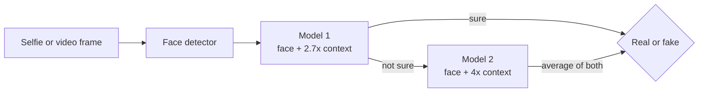

# Face Liveness Detection for Banking eKYC (Face Anti-Spoofing)

When a customer opens a bank account online (eKYC or Video KYC), the bank asks for a selfie. A fraudster can
show the camera a **printed photo**, a **video on a phone or laptop screen**, or a **mask** of someone else.
This project checks, in real time and on an ordinary CPU, whether the face is a **real live person** or a
**fake**.

It starts from Minivision's small open-source model (MiniFASNet), improves it with fraud-aware training, and
measures the result the way a bank would: how many fakes get through, how many real customers get wrongly
rejected, how fast it runs, and what that means per million checks.

## Key results

- **95.0% AUC** on 5,466 photos of people the model never saw during training (original model: 83.0%)
- **48% fewer fake faces let through** and **54% fewer real customers wrongly rejected**
- **Overall error cut by half** (ACER 28.2% to 14.4%)
- **Small:** 0.87 million parameters, 3.5 MB, about 100x smaller than ViT-Base (86M) models used in recent research
- **Fast:** 9.4 ms per face on CPU with ONNX Runtime, 2.5x faster than PyTorch with the same accuracy, no GPU needed
- **Efficient:** an early-exit design runs the second model for only 30% of faces, using 37% less compute

## Why it matters for a bank

A liveness check can make two kinds of mistakes, and both cost money:

| Mistake | Standard name | What it costs |
|---|---|---|
| A fake face is accepted | APCER | A fraudulent account is opened (identity theft, mule accounts, loan fraud) |
| A real customer is rejected | BPCER | The customer drops off or needs a costly manual review |

ACER is the average of the two. AUC and EER show how well the model separates real from fake overall
(higher AUC and lower EER are better). These are the ISO/IEC 30107-3 standard metrics for this task.

## How it works



Each model sees the face with some surrounding area, where screen edges, paper borders, reflections and
fingers usually show up. Most faces are decided by the first model alone; the second model is only used when
the first one is unsure.

### What this project adds

1. **Camera-quality simulation.** Real customer selfies are often blurry, dark, compressed or low resolution.
   These effects are added to both real and fake training photos, so the model learns to spot actual fraud
   signs instead of treating every poor-quality photo as fake.
2. **Synthetic fake generation.** Real faces are turned into extra training fakes by simulating screen
   patterns (moire, pixel grid), glare and printer dots, giving more attack variety without collecting new data.
3. **Frequency (FFT) training signal.** During training, the model also learns to predict the image's
   frequency pattern, where screen and print artefacts stand out. It is removed after training, so it adds no
   cost at run time.
4. **Real-vs-fake loss.** A training objective focused on the one decision the bank needs: real or fake.
5. **Early exit.** The second model runs only when the first one is unsure.
6. **ONNX Runtime deployment.** Runs without PyTorch on a normal CPU, tested against PyTorch and INT8 versions.

## Results

Tested on 5,466 photos (1,390 real, 4,076 fake) from the CelebA-Spoof test set. None of these people appear
in the training data. Decision threshold: 0.5.

| Metric | Original model | Fine-tuned (this project) | Change |
|---|---|---|---|
| AUC (higher is better) | 82.95% | **94.96%** | +12.0 points |
| EER (lower is better) | 25.66% | **11.86%** | 54% lower |
| ACER, overall error | 28.23% | **14.38%** | 49% lower |
| APCER, fakes accepted | 49.41% | **25.52%** | 48% lower |
| BPCER, real customers rejected | 7.05% | **3.24%** | 54% lower |

### Per 1 million checks (assuming 1% are fraud attempts)

| | Original model | Fine-tuned | Difference |
|---|---|---|---|
| Fake faces accepted | 4,941 | **2,552** | 2,389 fewer |
| Real customers wrongly rejected | 69,799 | **32,050** | 37,749 fewer |
| CPU time for 1M checks | 2.6 hours | 2.6 hours | same size and speed |

### What each part contributes (ablation study)

| Version | AUC | EER | ACER | ACER with early exit |
|---|---|---|---|---|
| **Full model** | **94.96%** | **11.86%** | **14.38%** | **14.51%** |
| Without frequency (FFT) training signal | 94.72% | 12.36% | 14.65% | 15.47% |
| Without camera-quality simulation | 92.50% | 15.96% | 16.78% | 16.80% |

Camera-quality simulation gives the biggest gain. The frequency training signal adds a further gain and cuts
the early-exit error by 6%. All versions (the original model and 6 training runs) are listed in [results/summary.md](results/summary.md).

### Speed and size (CPU, both models per face)

| Format | Time per face | Slowest 5% | Size | ACER | AUC |
|---|---|---|---|---|---|
| PyTorch | 23.25 ms | 24.98 ms | 3.81 MB | 14.38% | 94.96% |
| **ONNX Runtime (used in the app)** | **9.41 ms** | **10.98 ms** | **3.49 MB** | **14.38%** | **94.96%** |
| ONNX Runtime INT8 | 10.81 ms | 12.82 ms | 1.35 MB | 19.60% | 88.37% |

ONNX Runtime is 2.5x faster with exactly the same accuracy. INT8 is 2.6x smaller but less accurate, so the
app uses the full-precision version. With early exit, only 29.7% of faces need the second model, which brings
the estimated time from 21.7 ms to 13.6 ms per face in PyTorch (37% less compute) with almost the same
accuracy (ACER 14.51% vs 14.38%). Times were measured on a Kaggle CPU.

## Try it

```bash
pip install -r requirements.txt
streamlit run app/app.py   # web demo at http://localhost:8501: take a selfie or upload a photo
```

The web demo shows the original (`pretrained`) and the improved (`fine-tuned`) model side by side on the same
photo. For a live webcam loop, run `python app/webcam.py` (it needs the desktop OpenCV build; see the note at
the top of the file).

Use it in your own Python code (run from the project folder):

```python
import cv2
from fas.engine import LivenessEngine

engine = LivenessEngine("app/models/fine-tuned")
result = engine.predict(cv2.imread("selfie.jpg"))
print(result["verdict"], result["real_score"], result["ms_total"])
```

## Train it yourself (free Kaggle T4 GPU)

1. Run `python scripts/pack_kaggle.py`. It creates `dist/fas_project.zip`; upload it to Kaggle as a dataset named `fas-project`.
2. Open `notebooks/kaggle.ipynb` on Kaggle, turn on **GPU T4** and **Internet**, add the dataset, and click **Save & Run All**.
3. Download `fas_results.zip` from the notebook's Output and unzip it as `results/`. Then copy
   `results/app_models/original` to `app/models/pretrained` and `results/app_models/ours` to `app/models/fine-tuned`.

The notebook downloads part of CelebA-Spoof (45,160 training, 5,194 validation and 5,466 test photos), tests
the original model, trains each version (12 epochs, mixed precision, batch 256), tests them, exports ONNX
models and writes the report. Each step is also a script (run with `--help` for options):

| Script | What it does |
|---|---|
| `scripts/prepare_data.py` | downloads the data and cuts face crops |
| `scripts/train.py` | fine-tunes the models (standard, fraud-aware and ablation versions) |
| `scripts/evaluate.py` | computes the bank metrics, early-exit results and speed |
| `scripts/export.py` | exports ONNX and INT8 models and compares speed, size and accuracy |
| `scripts/report.py` | writes the results tables, impact per 1M checks and charts |

Training needs extra packages: `pip install -r requirements-train.txt`.

## Put the demo online (Streamlit Community Cloud, free)

1. Sign in at [share.streamlit.io](https://share.streamlit.io) with GitHub.
2. Click **Create app**, then **Deploy a public app from GitHub**.
3. Choose this repository, branch `main`, main file `app/app.py`, and click **Deploy**.

It installs `requirements.txt` and is live in a few minutes.

## Folders

```
fas/          core code: model, training transforms, data, metrics, inference engine
scripts/      data, training, evaluation, export and report steps
app/          Streamlit web demo (app.py), webcam demo (webcam.py), ONNX models (models/)
notebooks/    Kaggle notebook that runs everything end to end
pretrained/   Minivision's original model weights and the face detector
results/      results summary, metrics per run and charts
```

## Scope

Checks a single photo or video frame for print, screen-replay and mask attacks, trained and tested on
CelebA-Spoof. Deepfakes and camera-injection attacks need separate checks and are not covered.

## Credits and licences

- Code: Apache-2.0 (see `LICENSE`). Builds on Minivision's
  [Silent-Face-Anti-Spoofing](https://github.com/minivision-ai/Silent-Face-Anti-Spoofing) (model design,
  original weights, face detector); details in `NOTICE`.
- Data: [CelebA-Spoof](https://github.com/ZhangYuanhan-AI/CelebA-Spoof) (Zhang et al., ECCV 2020), for
  non-commercial research only. No dataset images are included here, and the fine-tuned models in
  `app/models/fine-tuned/` are for non-commercial research and demonstration use.
