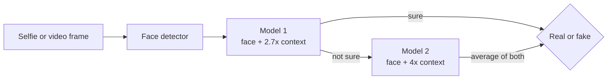
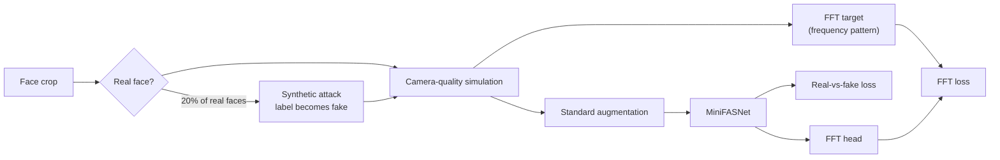

# Face Liveness Detection for Banking eKYC (Face Anti-Spoofing)


[](https://face-liveness-detection-ekyc-l9xwxiljybvnitbgarmp3b.streamlit.app/)

**Live demo:** https://face-liveness-detection-ekyc-l9xwxiljybvnitbgarmp3b.streamlit.app/ (take a selfie or
upload a photo; if the app is asleep, click the wake-up button and wait about 30 seconds)

When a customer opens a bank account online (eKYC or Video KYC), the bank asks for a selfie. A fraudster can
show the camera a **printed photo**, a **video on a phone or laptop screen**, or a **mask** of someone else.
This project checks, in real time and on an ordinary CPU, whether the face is a **real live person** or a
**fake**.

It starts from Minivision's small open-source model (MiniFASNet), improves it with fraud-aware training, and
measures the result the way a bank would: how many fakes get through, how many real customers get wrongly
rejected, how fast it runs, and what that means per million checks.

## Contents

- [Key results](#key-results)
- [The problem](#the-problem)
- [How it works](#how-it-works)
- [Model](#model)
- [Fraud-aware training](#fraud-aware-training)
- [Dataset](#dataset)
- [How it is measured](#how-it-is-measured)
- [Results](#results)
- [Deployment](#deployment)
- [Run it locally](#run-it-locally)
- [Train it yourself on Kaggle](#train-it-yourself-on-kaggle)
- [Put the demo online](#put-the-demo-online)
- [Project structure](#project-structure)
- [Scope and next steps](#scope-and-next-steps)
- [Credits and licences](#credits-and-licences)

## Key results

- **95.0% AUC** on 5,466 photos of people the model never saw during training (original model: 83.0%)
- **48% fewer fake faces let through** and **54% fewer real customers wrongly rejected**
- **Overall error cut by half** (ACER 28.2% to 14.4%)
- **Small:** 0.87 million parameters, 3.5 MB, about 100x smaller than ViT-Base (86M) models used in recent research
- **Fast:** 9.4 ms per face on CPU with ONNX Runtime, 2.5x faster than PyTorch with the same accuracy, no GPU needed
- **Efficient:** an early-exit design runs the second model for only 30% of faces, using 37% less compute

## The problem

Remote onboarding replaced the branch visit, so the phone camera is now the bank's front door. Regulators
expect a liveness check during video-based customer identification, because the most common attack needs no
technical skill: holding up someone else's photo or video. These are called **presentation attacks**:

| Attack | Example |
|---|---|
| Print | photo printed on paper, poster, cut-out |
| Replay | photo or video shown on a phone, tablet or laptop screen |
| Mask | paper, cloth or 3D mask of another person |

This project does **passive** liveness: it decides from a single frame, so the customer does not have to blink,
turn or follow instructions. That keeps onboarding fast and works on any phone camera.

A liveness check can make two kinds of mistakes, and both cost money:

| Mistake | Standard name | What it costs |
|---|---|---|
| A fake face is accepted | APCER | A fraudulent account is opened (identity theft, mule accounts, loan fraud) |
| A real customer is rejected | BPCER | The customer drops off or needs a costly manual review |

## How it works



1. **Find the face.** A RetinaFace detector finds the face and its box.
2. **Crop with context.** The box is enlarged 2.7x and 4x around its centre and resized to 80x80 pixels. The
   surroundings matter: screen edges, paper borders, reflections and fingers usually show up there.
3. **Score.** Model 1 gives the probability that the face is live. If it is sure (below 0.1 or above 0.9), the
   decision is made. Otherwise model 2 also scores the face and the two probabilities are averaged.
4. **Decide.** The face is accepted as real if the score is at least 0.5.

## Model

| | Model 1 | Model 2 |
|---|---|---|
| Architecture | MiniFASNetV2 | MiniFASNetV1SE (with squeeze-and-excitation) |
| Context around the face | 2.7x | 4x |
| Input | 80x80 colour crop | 80x80 colour crop |
| Parameters | 434,560 | 433,586 |
| ONNX file size | 1.74 MB | 1.74 MB |
| Output | probabilities for live and two attack families | same |

Both models start from Minivision's pretrained weights and are fine-tuned separately. During training each
model also has a small **frequency (FFT) head** (3 convolution layers, 222,339 parameters) that is dropped
before export, so the deployed models stay at 0.87M parameters in total.

## Fraud-aware training

Every training photo goes through this pipeline:



### 1. Camera-quality simulation (real and fake faces alike)

Real customer selfies are often compressed, dark, blurry or taken on cheap cameras. If only fakes looked like
that, the model would learn "bad photo = fake" and reject honest customers. Each effect is applied with a 15%
chance to every training face, real or fake:

| Effect | What it imitates | Setting |
|---|---|---|
| JPEG compression | compressed uploads | quality 25 to 75 |
| Sensor noise | small or cheap sensors | Gaussian noise, strength 2 to 10 |
| Low light | dark rooms | brightness x0.35 to x0.7, gamma 1.1 to 1.6, plus noise |
| Blur | shaky hands, missed focus | Gaussian 3 to 5 px or motion blur 3 to 7 px |
| Low resolution | old phones, digital zoom | downscaled to 40-70% and back |
| Colour cast | wrong white balance | blue and red channels x0.85 to x1.15 |

### 2. Synthetic attack generation (real faces turned into fakes)

20% of real faces are turned into a fake with one or two of these effects and relabelled as fake. This adds
attack variety without collecting new attack data:

| Effect | What it imitates |
|---|---|
| Moire pattern | a camera filming a screen (two interfering line patterns, coloured fringes) |
| Screen pixel grid | the red, green and blue sub-pixels of an LCD or OLED screen, bluish tint, grey blacks |
| Glare | a reflection on glossy photo paper or a screen |
| Print halftone | a printed photo: weaker colours, paper tint, ink spread and a dot pattern |

### 3. Frequency (FFT) training signal

Screens and printers leave regular patterns that are easier to see in the frequency domain than in pixels.
The FFT head learns to predict a 10x10 map of the image's frequency spectrum. The map is computed **after** the
synthetic attacks, so the model is taught to notice those patterns. The head is used only during training.

### 4. Real-vs-fake loss

The pretrained models output three classes (live and two attack families). Instead of forcing every fake into
one class, the loss adds up the probabilities of both attack classes and optimises the one decision the bank
needs, real or fake:

```
loss = 0.5 x classification loss + 0.5 x FFT loss
classification loss = -[ y x log p(live) + (1 - y) x log(p(attack 1) + p(attack 2)) ]
```

### Standard augmentation and training setup

All versions also use the original recipe: random crop (90-100% of the area), brightness, contrast and
saturation changes of up to 40%, hue shift, rotation up to 10 degrees and horizontal flip.

| Setting | Value |
|---|---|
| Optimiser | SGD, momentum 0.9, weight decay 5e-4 |
| Learning rate | one-cycle schedule, peak 0.01, 10% warm-up |
| Epochs and batch | 12 epochs, batch 256 |
| Precision | mixed precision (fp16) |
| Model selection | epoch with the lowest validation ACER |
| Hardware | Kaggle, one NVIDIA T4 GPU |

## Dataset

[CelebA-Spoof](https://github.com/ZhangYuanhan-AI/CelebA-Spoof) (ECCV 2020) is one of the largest face
anti-spoofing datasets: 625,537 images of 10,177 people, with print, replay and mask attacks captured on many
devices and in many scenes. This project uses a slice of the
[Hugging Face copy](https://huggingface.co/datasets/Ar4ikov/celebA_spoof):

| Split | Files used | Faces | Use |
|---|---|---|---|
| Train | 10 of 93 | 45,160 | training |
| Validation | 1 of 9 | 5,194 | choosing the best epoch |
| Test | 6 of 65 | 5,466 (1,390 real, 4,076 fake) | final results only |

The test people do not appear in the training data, so the results show how the model handles new customers.
No dataset images are stored in this repository; they are downloaded when the notebook runs.

## How it is measured

The metrics follow ISO/IEC 30107-3, the international standard for testing presentation attack detection:

| Metric | Meaning | Better |
|---|---|---|
| APCER | share of fake faces accepted | lower |
| BPCER | share of real customers rejected | lower |
| ACER | average of APCER and BPCER | lower |
| EER | error rate at the threshold where APCER equals BPCER | lower |
| AUC | how well the scores separate real from fake over all thresholds | higher |

Impact per million checks assumes 1% of attempts are attacks (10,000 attacks and 990,000 genuine customers).

## Results

All numbers are on the 5,466 test photos with decision threshold 0.5.

| Metric | Original model | Fine-tuned (this project) | Change |
|---|---|---|---|
| AUC (higher is better) | 82.95% | **94.96%** | +12.0 points |
| EER (lower is better) | 25.66% | **11.86%** | 54% lower |
| ACER, overall error | 28.23% | **14.38%** | 49% lower |
| APCER, fakes accepted | 49.41% | **25.52%** | 48% lower |
| BPCER, real customers rejected | 7.05% | **3.24%** | 54% lower |

### Per 1 million checks

| | Original model | Fine-tuned | Difference |
|---|---|---|---|
| Fake faces accepted | 4,941 | **2,552** | 2,389 fewer |
| Real customers wrongly rejected | 69,799 | **32,050** | 37,749 fewer |
| CPU time for 1M checks | 2.6 hours | 2.6 hours | same size and speed |

### What each part contributes (ablation study)

Each row removes one part of the fraud-aware training and trains again with everything else unchanged:

| Version | AUC | EER | ACER | ACER with early exit |
|---|---|---|---|---|
| **Full model** | **94.96%** | **11.86%** | **14.38%** | **14.51%** |
| Without frequency (FFT) training signal | 94.72% | 12.36% | 14.65% | 15.47% |
| Without camera-quality simulation | 92.50% | 15.96% | 16.78% | 16.80% |

Camera-quality simulation gives the biggest gain. The frequency training signal adds a further gain and cuts
the early-exit error by 6%. All versions (the original model and 6 training runs) are listed in
[results/summary.md](results/summary.md), with per-run metrics in [results/eval](results/eval).

## Deployment

### Speed and size (CPU, both models per face)

| Format | Time per face | Slowest 5% | Size | ACER | AUC |
|---|---|---|---|---|---|
| PyTorch | 23.25 ms | 24.98 ms | 3.81 MB | 14.38% | 94.96% |
| **ONNX Runtime (used in the app)** | **9.41 ms** | **10.98 ms** | **3.49 MB** | **14.38%** | **94.96%** |
| ONNX Runtime INT8 | 10.81 ms | 12.82 ms | 1.35 MB | 19.60% | 88.37% |

- **ONNX Runtime** is 2.5x faster than PyTorch with exactly the same accuracy, and needs no PyTorch install.
- **INT8 quantisation** (static, per-channel, calibrated on 300 face crops) makes the files 2.6x smaller but
  costs accuracy and is not faster on CPU, so the app uses the full-precision models.
- **Early exit** sends only 29.7% of faces to the second model. Estimated time drops from 21.7 ms to 13.6 ms
  per face in PyTorch (37% less compute) with almost the same accuracy (ACER 14.51% vs 14.38%).

Times were measured on a Kaggle CPU.

### Inference engine

`fas/engine.py` is the whole deployment path and needs only NumPy, OpenCV and ONNX Runtime:

```python
import cv2
from fas.engine import LivenessEngine

engine = LivenessEngine("app/models/fine-tuned")      # early_exit=0.1 and threshold from threshold.json by default
result = engine.predict(cv2.imread("selfie.jpg"))
print(result["verdict"], result["real_score"], result["ms_total"])
```

`predict` returns:

| Field | Meaning |
|---|---|
| `verdict` | `real`, `fake` or `no face` |
| `real_score` | probability that the face is live (0 to 1) |
| `threshold` | decision threshold used |
| `bbox`, `face_confidence` | face box `[x, y, w, h]` and detector confidence |
| `models_run` | 1 if early exit decided, 2 if both models ran |
| `ms_detect`, `ms_liveness`, `ms_total` | time spent per step in milliseconds |

Each ONNX model takes a float tensor `input` of shape N x 3 x 80 x 80 (BGR pixel values 0 to 255, no
normalisation) and returns `probs` of shape N x 3, where index 1 is the live class.

## Run it locally

```bash
pip install -r requirements.txt
streamlit run app/app.py      # web demo at http://localhost:8501
```

Take a selfie or upload a photo: the original (`pretrained`) and improved (`fine-tuned`) models check the same
face side by side, with scores, timings and the number of models used. The sidebar turns early exit on or off.

For a live webcam loop with a smoothed score, run `python app/webcam.py`. It opens a desktop window, so it
needs the desktop OpenCV build (see the note at the top of the file).

## Train it yourself on Kaggle

Training runs on a free Kaggle T4 GPU; nothing heavy runs locally.

1. Run `python scripts/pack_kaggle.py`. It creates `dist/fas_project.zip`; upload it to Kaggle as a dataset
   named `fas-project`.
2. Open `notebooks/kaggle.ipynb` on Kaggle, turn on **GPU T4** and **Internet**, add the dataset and click
   **Save & Run All**.
3. Download `fas_results.zip` from the notebook's Output and unzip it as `results/`. Then copy
   `results/app_models/original` to `app/models/pretrained` and `results/app_models/ours` to
   `app/models/fine-tuned`.

The first notebook cell holds the settings: data size (`TRAIN_FILES, VALID_FILES, TEST_FILES = 10, 1, 6`),
`EPOCHS, BATCH = 12, 256` and `RUN_ABLATIONS = True`. The notebook downloads and crops the data, tests the
original model, trains and tests every version, exports the ONNX models and writes the report.

Every step is also a script you can run on its own (`--help` lists all options):

| Script | What it does | Main options |
|---|---|---|
| `scripts/prepare_data.py` | downloads the data and cuts 2.7x and 4x face crops | `--train --valid --test` (number of files) |
| `scripts/train.py` | fine-tunes both models | `--aug standard/fraud`, `--loss ce/live_vs_attack`, `--no_fft`, `--disable <effect>`, `--epochs` |
| `scripts/evaluate.py` | metrics, early exit and CPU speed for one model set | `--models <folder> --tag <name>` |
| `scripts/export.py` | ONNX and INT8 export with speed, size and accuracy benchmark | `--models <folder> --name <name>` |
| `scripts/report.py` | results tables, impact per 1M checks and charts | `--volume`, `--fraud_rate` |
| `scripts/pack_kaggle.py` | zips the code and pretrained weights for Kaggle | |

Training needs extra packages: `pip install -r requirements-train.txt`.

## Put the demo online

The [live demo](https://face-liveness-detection-ekyc-l9xwxiljybvnitbgarmp3b.streamlit.app/) runs free on
Streamlit Community Cloud. To host your own copy:

1. Sign in at [share.streamlit.io](https://share.streamlit.io) with GitHub.
2. Click **Create app**, then **Deploy a public app from GitHub**.
3. Choose this repository, branch `main`, main file `app/app.py`, and click **Deploy**.

It installs `requirements.txt` and is live in a few minutes.

## Project structure

```
fas/                      core library
  network.py              MiniFASNetV2 and MiniFASNetV1SE
  model.py                training wrapper with the FFT head, real-vs-fake loss, weight loading
  augment.py              camera-quality simulation, synthetic attacks, standard augmentation, FFT target
  data.py                 dataset download, face cropping, PyTorch dataset with RAM cache
  metrics.py              APCER, BPCER, ACER, AUC, EER, early-exit evaluation
  engine.py               deployment: face detector, crops, ONNX or PyTorch models, verdict
scripts/                  command-line steps (data, train, evaluate, export, report, Kaggle packaging)
app/
  app.py                  Streamlit web demo
  webcam.py               live webcam demo
  models/                 ONNX models: pretrained/ and fine-tuned/
notebooks/kaggle.ipynb    end-to-end run on Kaggle
pretrained/               Minivision's original weights and the RetinaFace face detector
results/                  summary.md, metrics per run, charts
```

## Scope and next steps

This project checks a single photo or video frame for print, screen-replay and mask attacks, trained and
tested on CelebA-Spoof. Deepfakes and camera-injection attacks need separate controls and are not covered.

Natural next steps: scoring several video frames per session, training on more of CelebA-Spoof and other
anti-spoofing datasets, and testing on selfies captured in real onboarding conditions.

## Credits and licences

- **Code:** Apache-2.0 (see `LICENSE`). Builds on Minivision's
  [Silent-Face-Anti-Spoofing](https://github.com/minivision-ai/Silent-Face-Anti-Spoofing): model design,
  pretrained weights, FFT head idea, crop rule and face detector. Details in `NOTICE`.
- **Data:** CelebA-Spoof, Zhang et al., "CelebA-Spoof: Large-Scale Face Anti-Spoofing Dataset with Rich
  Annotations", ECCV 2020. For non-commercial research only.
- **Models:** the fine-tuned models in `app/models/fine-tuned/` were trained on CelebA-Spoof and are for
  non-commercial research and demonstration use.
